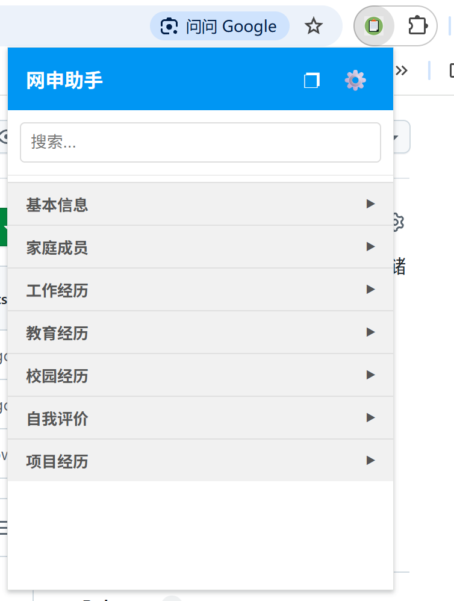
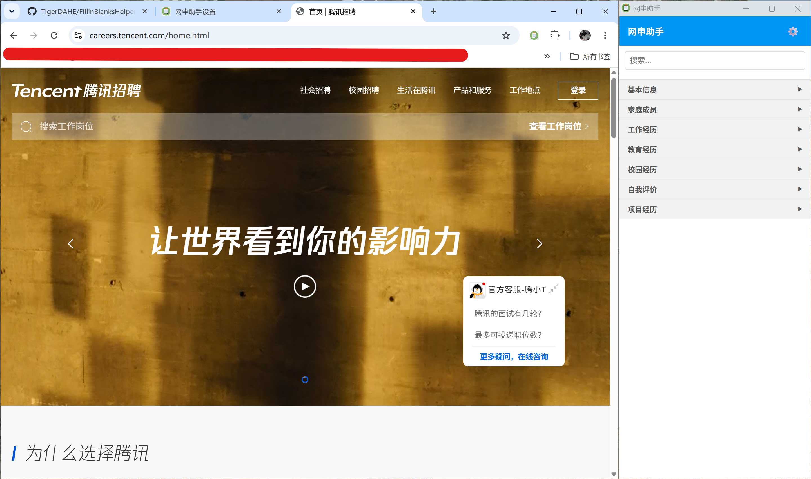

# 网申填表小助手 FillinBlanksHelper
将网申所需填写的信息以json格式存储在用户本地的剪贴板插件，轻量、简单、灵活。

## 使用方式
将src文件夹作为插件导入至Chrome浏览器或者Edge浏览器即可。

## 功能特点
- 所有数据均存储在本地，无需担心隐私泄露。
- 用户可自定义分组与标题，如个人信息分组下可以包括姓名、性别、民族、籍贯等。
- 用户可以根据求职场景一键保存/切换信息，实现不同岗位或单位的网申表述灵活转换，如互联网大厂场景、央国企场景、考公考编场景。
- 本质是一个剪贴板工具，任何需要重复填写的工作均可以使用本插件。

## 演示

